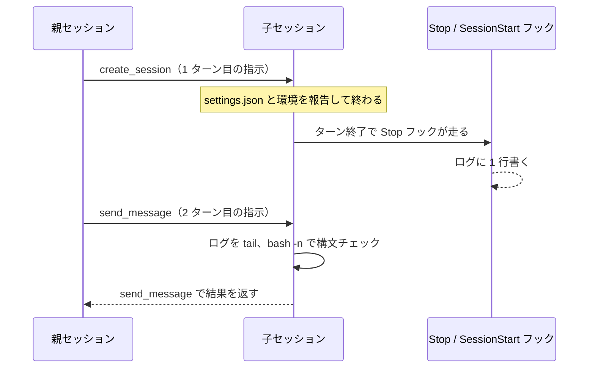

## TL;DR

- リポの `.claude/settings.json` に書いたフックは、そのリポを主にしたセッションでしか動きませんでした。そこで環境のセットアップスクリプトから **`~/.claude/settings.json` に jq でマージ**して配りました
- docs に載せたスニペットをそのまま bats で動かすテストを書き、33 件すべて通りました
- それでも、親セッションに子セッションを作らせて **1 ターン目で Stop させ、2 ターン目でログを見る**実機確認をしたところ、Stop は動いていた一方で **SessionStart は一度も動いていませんでした**
- 原因は `... 2>&1 &; else` の `&;`。bash の構文エラーなのにエラーもログも残っていませんでした。`bash -n <(jq -r ... settings.json)` で見つけました

## はじめに

<!-- hearing:H2 -->
Claude Code のクラウドセッション（claude.ai から動かすセッション）で、Stop ごとに会話ログを S3 に上げるフックを使っています。

実機で確かめた理由は 3 つあります。テストが全部通っていても、クラウドで本当に Stop が走るかは実機でしか分からないと思ったこと。会話ログを集める仕組みなので、上がっていないことに気づかないのが一番怖かったこと。そして、その確認を自分の手ではなく AI に任せたかったことです。

不安だから確かめたいのに、できるだけ自分で判断しなくて済むようにもしたい。矛盾しているのは分かっていて、ちょうどいいトレードオフをずっと探しています。今回の「親セッションが子セッションを作って確かめさせる」やり方は、その途中で見つけた 1 つの答えです。

## 全体像

やったことは 2 段です。

1. フックをユーザー設定（`~/.claude/settings.json`）に配る
2. 配ったフックが動くかを、子セッションで実機確認する

実機確認の流れは以下です。



Stop フックの結果は、そのターンが終わってからでないと見えません。なので確認は必ず 2 ターンに分けます。

## Step 0: リポに置いたフックが、他のリポで読まれない

<!-- hearing:H3 -->
最初に困ったのはここでした。

フックはフック本体を置いたリポ（以下、hooks リポ）の `.claude/settings.json` に書いていました。hooks リポを開いたセッションでは動きます。ところが、別のリポを主にしたセッションでは会話ログが上がっていませんでした。

hooks リポを「追加リポジトリ」として同じセッションに添付しても、読まれるのは主リポジトリ側の設定だけのようで、フックは動きませんでした。

そこで、どのリポのセッションでも読まれるユーザー設定 `~/.claude/settings.json` に、**絶対パスで**フックを書くことにしました。

## Step 1: セットアップスクリプトから jq でマージする

クラウド環境のセットアップスクリプトに、以下を足しました。

<!-- snippet:begin -->
```bash
if [ "${CLAUDE_CODE_REMOTE:-}" = "true" ] && command -v jq >/dev/null 2>&1; then
  f="$HOME/.claude/settings.json"; s=/home/user/hooks-repo/scripts/cloud-transcript-upload.sh
  mkdir -p "$HOME/.claude"; [ -s "$f" ] || echo '{}' > "$f"
  t=$(mktemp) && jq --arg s "$s" '
    def keep: map(select(([.hooks[]?.command] | any(contains($s))) | not));
    def run(a): "if [ -f " + $s + " ]; then " + a + "; else mkdir -p ~/.claude/logs; echo \"$(date -u +%FT%TZ) skip: hooks repo not attached\" >> ~/.claude/logs/cloud-transcript-upload.log; fi";
    .hooks.Stop = ((.hooks.Stop // []) | keep) + [{hooks: [{type: "command", command: run("bash " + $s), timeout: 120}]}]
    | .hooks.SessionStart = ((.hooks.SessionStart // []) | keep) + [{matcher: "startup|resume", hooks: [{type: "command", command: run("(nohup bash " + $s + " --ensure-aws </dev/null >/dev/null 2>&1 &)")}]}]
  ' "$f" > "$t" && [ -s "$t" ] && cp "$t" "$f"; rm -f "$t"
fi
```
<!-- snippet:end -->

これは修正後の版です。ポイントは以下です。

- **クラウドだけで動く**: `CLAUDE_CODE_REMOTE` が `true` でなければ何もしません。手元の PC の設定は変わりません
- **何度走らせても同じ結果**: `keep` で自分のフック（パス `$s` を含むもの）を一度外してから足します。他のフックは残ります
- **壊れた JSON は上書きしない**: jq が失敗すると `$t` が空になり、`[ -s "$t" ]` で止まります
- **hooks リポが無いセッションでも落ちない**: 本体が無ければ、ログに `skip: hooks repo not attached` を 1 行書いて終わります
- SessionStart では `--ensure-aws` を裏で走らせ、aws CLI が無いときだけ入れます

## Step 2: docs のスニペットを、そのまま bats で動かす

docs に載せたスニペットと、テストが動かすスクリプトが別物になるのを避けたかったので、docs から囲みを切り出して実行するテストにしました。

```bash
sed -n '/user-hook-snippet:begin/,/user-hook-snippet:end/p' "$DOC" | sed '/^<!--/d; /^```/d' > "$SNIPPET"
```

一時ディレクトリを `HOME` にして、PC では何も書かないこと、既存の設定とマージされること、2 回走らせても同じになること、壊れた JSON を触らないこと、などを確かめます。フック本体側のテストと合わせて 33 件、全部通りました。

出典: スニペットのテスト 7 件 + 本体のテスト 26 件（2026-11-04 時点）（S01, S02）

ここまでで、正直「もう動く」と思っていました。

## Step 3: 親セッションに子セッションを作らせ、1 ターン目で Stop させる

実機確認は、親のセッションに `create_session` で子セッションを作らせて任せました。1 ターン目の指示はこうです（抜粋）。

```text
コードは変更しません。このターンでは次だけ行い、結果を簡潔に報告して終わってください
（このターンの終わりに Stop フックが走り、次のターンでログを見ます）。
1. cat ~/.claude/settings.json で hooks.Stop と hooks.SessionStart にエントリがあるか報告
2. フック本体のスクリプトの有無を報告。無ければ add_repo で hooks リポを足して clone する
3. CLAUDE_CODE_REMOTE などの環境変数を報告（バケット名・キーは出さない）
4. aws --version を報告
```

「何もしないで報告だけして終わる」のがコツです。ターンが終われば Stop フックが走るので、子は何もしなくてもフックの試験台になります。

1 ターン目の報告で分かったのは以下です。

- セットアップスクリプトは効いていて、`~/.claude/settings.json` に Stop と SessionStart が入っていた
- 子セッションには hooks リポが添付されておらず、子がその場で clone した
- 子が「SessionStart の command に `&;` という書き方があり、構文エラーになる可能性がある」と書き添えていた

最後の指摘を受けて、親は 2 ターン目の指示（`send_message`）に構文チェックを足しました。

```bash
tail -5 ~/.claude/logs/cloud-transcript-upload.log
ls ~/.claude/projects/
bash -n <(jq -r '.hooks.SessionStart[0].hooks[0].command' ~/.claude/settings.json) \
  && echo sessionstart_syntax_ok || echo sessionstart_syntax_error
```

2 ターン目の結果です。

```text
2026-11-05T14:35:13Z done: uploaded=1 failed=0 files=1
---
/dev/fd/63: line 1: syntax error near unexpected token `;'
sessionstart_syntax_error
```

Stop フックは 1 ターン目の終わりに動いて、S3 に 1 ファイル上げていました。SessionStart は構文エラーでした。

出典: 実機確認用の子セッションの会話ログ（2026-11-05）（S07）

## ハマりどころ: テストが緑なのに、SessionStart は一度も動いていなかった

<!-- hearing:H3 -->
一番ショックだったのはここです。

### 症状

子セッションは開始時点で hooks リポが無かったので、SessionStart は `skip: hooks repo not attached` を 1 行書くはずでした。ところがログにあったのは Stop の 1 行だけで、skip の行がありません。セッションは普通に始まっていて、エラーも見えませんでした。

### 原因

修正前の jq はこう書いていました。

```jq
run("nohup bash " + $s + " --ensure-aws </dev/null >/dev/null 2>&1 &")
```

`run(a)` は `"if [ -f ... ]; then " + a + "; else ..."` を組み立てるので、できあがるコマンドは以下になります。

```bash
if [ -f ... ]; then nohup bash ... --ensure-aws </dev/null >/dev/null 2>&1 &; else ...; fi
```

`&` はそれ自体がコマンドの区切りなので、直後に `;` は置けません。bash は `syntax error near unexpected token ';'` で、if 文全体を実行しません。Stop 側は末尾が `&` ではないので問題ありませんでした。

修正前のスニペットを手元で動かすと、今でも再現します。

出典: 2026-11-04 時点のスニペットが書く Stop は `bash -n` を通り、SessionStart は通らない（S03）

### なぜテストで見つからなかったか

テストは SessionStart について「コマンド文字列にパスが含まれるか」と「件数が 1 件か」しか見ていませんでした。`bash -n` にも、実行にもかけていません。文字列としては正しく組み立てられているので、緑になります。

出典: 2026-11-04 時点のテストは SessionStart を `bash -n` にも実行にもかけていなかった（S06）

### 対処

`nohup ... &` を `( )` で包んで、サブシェルの中で裏に回すようにしました。

```jq
run("(nohup bash " + $s + " --ensure-aws </dev/null >/dev/null 2>&1 &)")
```

`(...)` の後ろなら `;` を置けます。あわせてテストを 2 件足しました。

- 生成された Stop / SessionStart のコマンドが `bash -n` を通る
- SessionStart のコマンドをダミーのスクリプトで実際に走らせ、exit 0 で `--ensure-aws` 付きで呼ばれる

修正は見つけた翌日の 2026-11-06 に main に入りました。修正版は 2 回走らせてもフックはそれぞれ 1 件のままで、両方 `bash -n` を通ります。

出典: 修正版のスニペットとテスト 9 件（S04, S05）

### settings.json のフックを構文チェックする 1 行

自分の環境のフックも、以下で確かめられます。

```bash
jq -r '.hooks[][].hooks[].command' ~/.claude/settings.json | while IFS= read -r c; do
  bash -n <(printf '%s\n' "$c") && echo "ok: ${c:0:60}" || echo "NG: ${c:0:60}"
done
```

`jq -r` で 1 フック 1 行で取り出し、それぞれを `bash -n`（実行せず構文だけ確かめる）にかけます。

修正前のスニペットが書いた設定なら、SessionStart の行が NG になります。この記事に載せたスニペットは、2 回走らせてもフックが 1 件ずつのままで、どちらも ok になることを確かめてあります。

出典: 記事のスニペットと構文チェックの再実行（S08）

## 振り返り: 実機確認を後回しにしていた

<!-- hearing:H4 -->
失敗だったと思うのは、実機確認を PR の後に回したことです。

最初の PR は「実機確認はユーザー作業」として出していて、確かめたのは main に入った翌日でした。

出典: main に入ったのが 2026-11-04、実機確認が 2026-11-05（S01, S07）実機確認を最初から受け入れ基準に入れて、PR を出す前にやるべきでした。

子セッションに任せるやり方なら、自分の手間はほとんど増えません。1 ターン目で設定を報告させて Stop を走らせ、2 ターン目でログと `bash -n` を見る。これを「テストが通った後、PR を出す前」に挟むのが、今のところ自分なりのトレードオフです。

## まとめ

リポに置いたフックが他のリポで読まれないなら、セットアップスクリプトから `~/.claude/settings.json` に jq でマージして配れます。ただし、生成したコマンドは文字列を見るだけでは足りません。

**`bash -n` にかけること、そして子セッションに 1 ターン終わらせて実機のログを見ること。** この 2 つで、テストが緑のまま黙って止まっていたフックを見つけられました。

<!-- 出典の再検証: bash scripts/verify-sources.sh claude-code-user-hook-live-check -->
