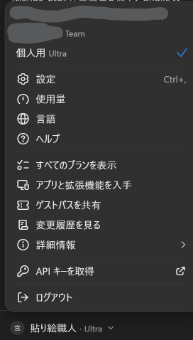
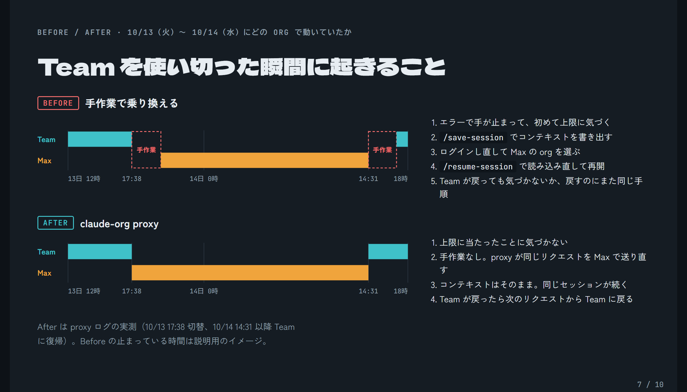
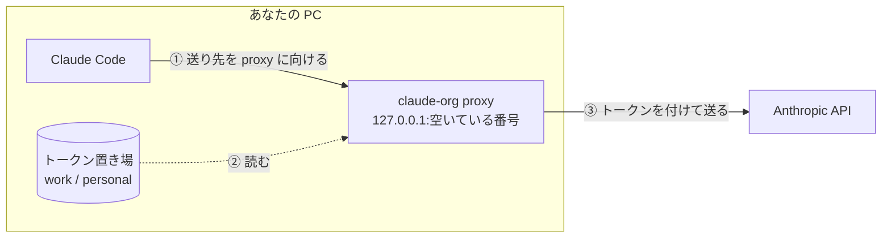
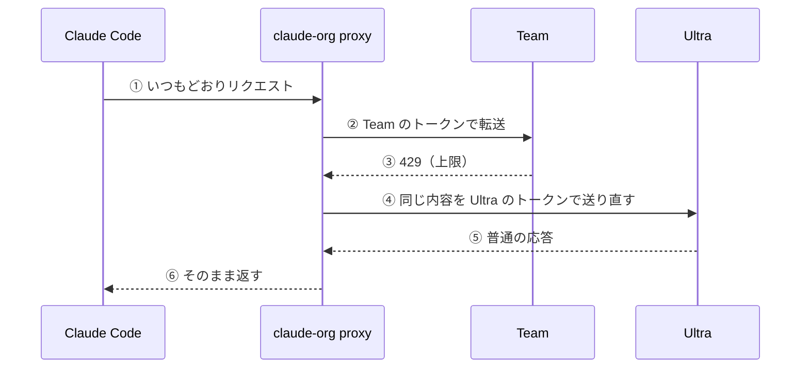

:::message
本記事は個人の運用記録です。複数 org の切替・トークン運用・ローカル proxy による認証ヘッダ差し替えは、各読者の環境・契約で利用規約に照らして自己責任で判断してください。本ツールは**自分が所属する org の、自分のトークン同士の切替**だけを扱い、他人のリクエストは中継しません。
:::


*claude.ai のアカウントメニュー。1 つのアカウントで、会社の Team の org と個人用の org の両方に入っている状態*

## TL;DR

- 会社の **Team org（もしくは Enterprise）** と個人の **Ultra org** を併用していると、片方の上限で Claude Code が止まり、org の選び直しとセッションの引き継ぎが毎回発生する
- `claude` の代わりに `claude-org proxy` と打つだけで、**上限（429）に当たった瞬間に同じリクエストを別 org のトークンで送り直す** CLI `claude-org` を作った
- 実測 10 日間で自動切替 11 回、上限で作業が止まった回数 **0 回**。止まった原因は 5 時間枠ではなく **週の上限**だった
- 依存パッケージなしの Node CLI。`npm install -g claude-org`、Windows / macOS / Linux 対応

:::message
本記事の「Team」「Team org」は、**Enterprise プランの org にも置き換えられます**。どちらも会社が契約する org 単位のプランです（[Claude の料金プラン: Team & Enterprise](https://claude.com/ja/pricing#team-&-enterprise)）。
:::

## はじめに

<!-- hearing:H2 -->
Claude Code を毎日使っていて、個人の Ultra プランでも週の途中で token が尽きるようになりました。そこで会社が契約した Team の org も使い始めました。使ってみた感覚では、Team の 1 席分は Pro プランとほぼ同じ量です。同じメールアドレスで 2 つの org に入っている状態です。

token が足りない問題は、Team を足すことでいったん解決しました。ところが Team と Ultra の 2 つを使い分け始めると、今度は**使い方そのものに手間がかかる**ようになりました。

## Team と Ultra を併用して困ったこと

<!-- hearing:H3 -->
| 困りごと | 中身 |
|---|---|
| 使えないモデルがある | Team では利用できないモデルがある（これは仕方ない） |
| 切り替えがしんどい | Ultra と Team の両方を使うと、毎回 org を選び直す |
| 使用量の上限 | 単発なら平気。並列セッションだとすぐ枯渇し、リセットまで待ち |
| 引き継ぎが冗長 | セッションを保存 → ログインし直し → 新セッションで読み込み直し、を毎回 |

欲しかったのは一言でいうと **「Team の token を使っていて、上限に来たら勝手に Ultra に移ってほしい」** でした。

Claude Code 標準の選択肢は、上限に来たら「リセットまで待つ」か「追加の使用量を買う」です。複数アカウントを `/login` で切り替えることはできますが、セッションの外から手でやる操作です。`claude-org` が足すのは 3 つ目の選択肢、**「もう払っている Ultra を使う」**です。

## 作ったもの: claude-org

コマンドは `claude` の代わりに `claude-org proxy` と打つだけです（短い別名 `ccorg` も入ります）。


*上: 手作業で乗り換える場合（止まっている時間は説明用のイメージ）。下: claude-org proxy の実測。10/13 17:38 に Team が上限に当たって Ultra に切り替わり、10/14 14:31 以降 Team に戻った*

| | Before（手作業） | After（claude-org proxy） |
|---|---|---|
| 上限に当たったとき | エラーで手が止まって、初めて気づく | 当たったことに気づかない |
| 乗り換え | セッションを保存して、Ultra でログインし直す | 同じセッションのまま Ultra で続く |
| Team が戻ったら | また同じ手順で戻す | 次のリクエストから自動で Team に戻る |

### 対象の人

- Team の org と、個人の org（Pro / Max）の 2 つを持っている（Team 同士・個人同士の組み合わせでも動きます）
- Claude Code を CLI で使っている
- **Free のアカウントでは使えません**。トークンの発行に使う `claude setup-token` は Pro / Max / Team / Enterprise の契約が必要です

## 仕組み: 上限の応答だけ、別の org で送り直す

`claude-org proxy` を実行すると、まず自分の PC の中だけで動く proxy（`127.0.0.1` の空いているポート）を立ち上げ、次に Claude Code を起動して送り先（`ANTHROPIC_BASE_URL`）をその proxy に向けます。



`127.0.0.1` は「この PC 自身」を指す住所なので、ほかの PC からは proxy に届きません。proxy は 1 セッションに 1 つで、Claude Code を閉じると一緒に止まります。org のトークンを持つのは proxy だけで、Claude Code 側にはそのセッション限りの合言葉しか渡しません。

1 回のリクエストで起きていることはこうです。



③〜⑤ は proxy の中だけで起きます。Claude Code には ⑥ しか届かないので、上限に当たったことに気づかないままセッションが続きます。再起動も `--resume` も要りません。

細かい挙動:

- 上限の判定は、応答ヘッダ `anthropic-ratelimit-unified-5h-status` と 429 の本文で行います
- 上限中の org は、リセット時刻まで順番の末尾に回すだけで消しません。リセット時刻を過ぎれば元の順番に戻ります
- ストリーミング（SSE）の応答は加工せずそのまま流します
- 送り直すときは `Authorization` ヘッダだけを差し替え、`anthropic-beta` などのヘッダは落としません

## 導入手順

Windows（PowerShell）と macOS / Linux（zsh / bash）の両方の手順を載せています。この記事だけで導入できます。

https://github.com/miyashita337/claude-org

### 1. インストール（共通）

Node.js 18 以上と Claude Code（`claude` コマンド）が入っていることが前提です。

```bash
npm install -g claude-org
```

`claude-org` と、短い別名 `ccorg` の 2 つのコマンドが入ります。

### 2. org ごとにトークンを発行（共通）

```bash
claude setup-token
```

**Team の org で 1 回、Ultra の org で 1 回、合わせて 2 回**実行します。

### 3. トークンを保存して起動

ファイル名の `work` / `personal` は自分で決めるラベルです（ここでは work = Team、personal = Ultra）。

**Windows（PowerShell）**

```powershell
# 改行なしで保存
$d = "$env:USERPROFILE\.claude\org-tokens"
New-Item -ItemType Directory -Force $d | Out-Null
Set-Content -NoNewline "$d\work.token" "<Team の org で発行したトークン>"
Set-Content -NoNewline "$d\personal.token" "<Ultra の org で発行したトークン>"

# 試す順番を指定して起動
$env:CLAUDE_ORG_ORDER = "work,personal"
claude-org proxy
```

**macOS / Linux（zsh / bash）**

```bash
# 改行なしで保存し、自分だけが読める権限にする
mkdir -p ~/.claude/org-tokens
printf '%s' '<Team の org で発行したトークン>' > ~/.claude/org-tokens/work.token
printf '%s' '<Ultra の org で発行したトークン>' > ~/.claude/org-tokens/personal.token
chmod 600 ~/.claude/org-tokens/*.token

# 試す順番を指定して起動
export CLAUDE_ORG_ORDER=work,personal
claude-org proxy
```

- macOS / Linux では **`chmod 600` を省略できません**。`printf` で作ったファイルは他のユーザーも読める権限（644）になり、proxy はそのファイルを `is readable by other users (mode 644); run: chmod 600 ...` と表示して使いません（Windows ではこの検査はありません）

### 4. 確認と常用の設定

```bash
claude-org status
```

- 各ラベルが意図した org を指しているか、認証状態と一緒に一覧で確認できます
- 順番を毎回指定しないで済ませるには、Windows は `[Environment]::SetEnvironmentVariable("CLAUDE_ORG_ORDER", "work,personal", "User")` を 1 回実行します。macOS / Linux は `export CLAUDE_ORG_ORDER=work,personal` を `~/.zshrc`（bash なら `~/.bashrc`）に書きます
- `CLAUDE_ORG_PREFER` に入るのは org 名 1 つだけです。順番のリストは `CLAUDE_ORG_ORDER` に書きます

## 効果: 10 日間の実測

自分の Windows 機 1 台で、proxy のログが残っていた 2026-10-10〜10-19 の分を集計しました。

| 指標 | 値 |
|---|---|
| Team で処理したリクエスト | 1,138 件 |
| Team が上限に当たった後、Ultra が引き継いだリクエスト | 約 1,100 件 |
| 自動切替 | 11 回 |
| 上限で作業が止まった回数 | **0 回** |

出典: 筆者の Windows 機の claude-org proxy ログ、2026-10-10〜10-19 の集計 <!-- S01 -->

### わかったこと: 本当の壁は 5 時間枠ではなく週の上限だった

<!-- hearing:H4 -->
作った当初は「5 時間枠で止まる」のを防ぐつもりでした。ところがログを見ると、話は違いました。

- Team の 5 時間枠の使用率は最大 78%（10/18）。この期間、5 時間枠には一度も当たっていません
- 止まった原因は **7 日間の上限**（ログ上の `claim=seven_day`）でした。10/13（火）17:38 に使い切り、10/14（水）の週リセットまで Team が使えませんでした
- その間の約 1,100 リクエストを Ultra が処理し、セッションはそのまま続きました
- 一番驚いたのは、**本人が当日、上限に当たったことを覚えていない**ことです。枯渇したと気づかないまま作業が続いていました
- Team で使えないモデルを指定したリクエストは Team で 429 になるので、18 回とも Ultra に回りました

出典: 同ログの 5h utilization・seven_day 判定・モデル別の集計 <!-- S02 -->

| org | リクエスト | 出力 | キャッシュ書込 | キャッシュ読込 |
|---|---|---|---|---|
| Team | 999 | 0.57M | 8.6M | 162M |
| Ultra | 1,020 | 0.42M | 6.2M | 207M |

token 数を突き合わせできた 2,019 件（全 2,326 件の 87%）の集計です。単位 M は 100 万 token。

出典: 同ログとセッション transcript の usage を突き合わせた集計 <!-- S03 -->

計測の範囲: proxy のログが残っていた 10/10 以降、この Windows 機の分だけです。10/1〜10/9 と、proxy を通さず起動したセッションは含みません。

## 注意点: proxy モードで変わること

- claude.ai にログインしていれば、**コネクタ（Slack・Notion 等の MCP）と Claude in Chrome も使えます**（v0.5.0 から）。起動時に `claude.ai connectors: on` と出ます。コネクタはログイン中の org のもので、proxy は通りません
- ログインしていない、または API キーを環境変数に入れている場合は、コネクタは使えません
- proxy モードでは prompt cache の保持時間と tool search が既定で変わるため、`CLAUDE_CODE_PROMPT_CACHE_TTL=1h` / `ENABLE_TOOL_SEARCH=true` で元に戻しています（自分で設定した値が優先されます）
- `~/.claude/` の設定とセッション履歴は org 間で共有されるので、proxy を通さない `claude --resume` でも同じセッションを開けます
- proxy は `127.0.0.1` でだけ待ち受け、トークンはログに出しません

## まとめ

- Team を先に使い切り、尽きたら Ultra で続ける。org の切り替えも、セッションの引き継ぎも手作業ゼロになりました
- Team の週上限に当たっていた約 21 時間も、作業が止まりませんでした
- 依存パッケージなしの Node CLI です。Windows / macOS / Linux で動きます

```bash
npm install -g claude-org
claude-org proxy
```

同じように 2 つの org を行き来している人の手間が減れば嬉しいです。

## 参考リンク

- リポジトリ: https://github.com/miyashita337/claude-org
- npm: https://www.npmjs.com/package/claude-org
- Claude Code の認証: https://code.claude.com/docs/en/authentication
- Legal & Compliance（OAuth 認証の用途規定）: https://code.claude.com/docs/en/legal-and-compliance

<!-- 出典の再検証: bash scripts/verify-sources.sh claude-org-5h-failover -->
