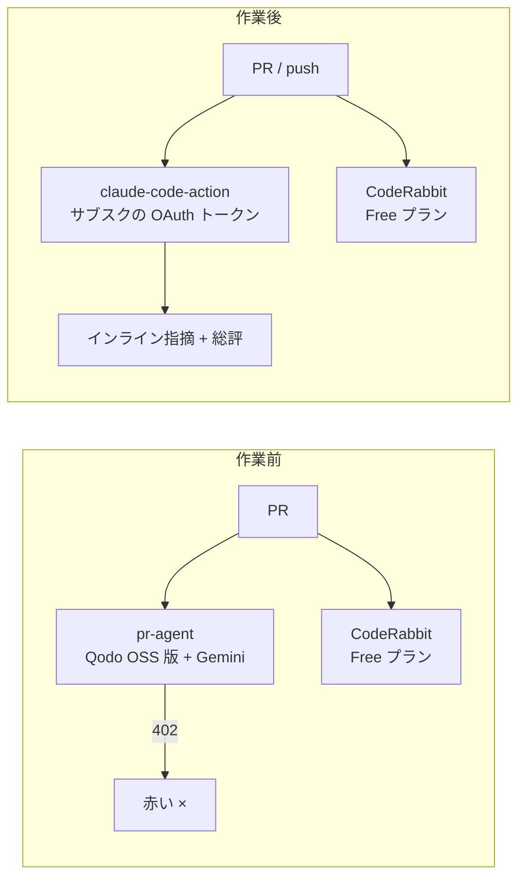

## TL;DR

- Claude のサブスクを契約していれば、**`claude setup-token` の OAuth トークンで `claude-code-action` を動かし、API の従量課金なしで PR の自動レビューを回せます**
- 自前で動かしていた pr-agent（Qodo の OSS 版）+ Gemini は、**前払いクレジットが尽きて HTTP 402** を返し、毎回の PR に赤い × を付けていました。無料枠だと思い込んでいたのが原因です
- pr-agent のモデルを Claude に替える案は、**API キー（従量課金）でしか動かず、既存の Claude レビューと二重になる**ので見送りました
- 個人の 9 リポに PR を出し、main に入ったのは 2 本です。運用はまだ途中で、次は最安の有料 Gemini で pr-agent を戻します

## はじめに

<!-- hearing:H2 -->
個人で持っているリポが 9 本あり、どれにも PR のレビュー Bot を入れたいと思っていました。条件は「**できるだけ安い方法で、高性能なレビュー Bot**」です。

調べてみると、多くのリポには以前入れた pr-agent がすでにありました。導入はほぼ終わっていて、問題は「動いていない」ことでした。

この記事では、Claude のサブスク枠で動く自動レビューを 9 リポに入れた手順と、その途中で pr-agent を外した理由をまとめます。

<!-- hearing:H1 -->
対象は、Claude の Pro / Max / Ultra を契約していて、個人の複数リポに追加の課金なしで AI レビューを入れたい人です。

## 全体像

最初にあった構成と、作業後の構成は以下です。



対象は 9 リポです。公開リポが 5 本（claude-hub / convert-service / claude-screenshot / lanch-app / dev_tool）、非公開リポが 4 本です。PR は 9 リポに 1 本ずつ出しました。

出典: GitHub の検索 API で、同じ作業ブランチの PR 数を数えた値（S01）

### 費用の仕組みの違い

レビュー Bot ごとに、お金がかかる仕組みがまったく違います。

| 経路 | 課金の仕組み | 無料で使える範囲 |
|---|---|---|
| claude-code-action + OAuth トークン | Claude のサブスク枠を消費（API 課金なし） | サブスクの利用上限まで |
| claude-code-action + API キー | API の従量課金（Sonnet 5.5 は 100 万トークンあたり入力 $2 / 出力 $10） | 新規ユーザーのお試しクレジットのみ |
| pr-agent + Gemini（有料枠） | 前払いクレジットから引き落とし（最低 $5） | なし（残高 0 で停止） |
| pr-agent + Gemini（無料枠） | 無料 | モデルごとの上限まで。ただし入力が Google の製品改善に使われる |
| CodeRabbit Free | 無料 | 非公開リポは PR の要約だけ。公開リポは OSS 向けの上限枠 |

出典: Claude Code GitHub Actions のドキュメント（S06）、Claude API の料金ページ（S07）、Gemini API の課金ドキュメント（S03）と料金ページ（S04）、CodeRabbit のプラン説明（S09）

Claude のサブスクは Pro が月 $20（年払いなら月 $17）、Max が月 $100、Ultra が月 $200 で、どれも Claude Code を含みます。すでに Claude Code を使うために払っているなら、レビューに追加の費用はかかりません。

出典: Claude の料金ページ（S05）

## Step 0: OAuth トークンを発行して Secret に登録する

手元の Claude Code でトークンを発行します。

```bash
claude setup-token
```

発行したトークンを、各リポの Settings > Secrets and variables > Actions に `CLAUDE_CODE_OAUTH_TOKEN` という名前で登録します。

個人アカウントのリポは Organization の共有 Secret が使えないので、リポごとに登録が必要です。9 リポ分を手で登録するのは面倒なので、`gh` でまとめて登録しました。

```bash
read -rs TOKEN   # 画面に表示せずに受け取る
for r in repo-a repo-b repo-c; do
  gh secret set CLAUDE_CODE_OAUTH_TOKEN -R "user/$r" --body "$TOKEN"
done
unset TOKEN
```

:::message
このトークンは、`claude setup-token` を実行した人のサブスクに紐づきます。チームで使う場合は、公式ドキュメントでも API キーを使う構成が案内されています（S06）。
:::

## Step 1: レビュー用の workflow を置く

`.github/workflows/claude_review.yml` を置きます。9 リポとも同じ内容です。要点だけ抜き出すと以下です。

```yaml
name: Claude PR Review
on:
  pull_request:
    types: [opened, synchronize, reopened, ready_for_review]

permissions:
  contents: read
  pull-requests: write
  issues: write

jobs:
  review:
    # draft と fork からの PR を除外し、本人とコラボレーターだけが起動できるようにする
    if: >-
      github.event_name == 'pull_request' &&
      !github.event.pull_request.draft &&
      github.event.pull_request.head.repo.full_name == github.repository &&
      contains(fromJSON('["OWNER","MEMBER","COLLABORATOR"]'), github.event.pull_request.author_association)
    runs-on: ubuntu-latest
    concurrency:
      group: claude-review-${{ github.event.pull_request.number }}
      cancel-in-progress: true   # 連続 push したら最新コミットだけレビュー
    timeout-minutes: 20
    steps:
      - uses: actions/checkout@v4
        with:
          ref: ${{ github.event.pull_request.base.sha }}  # PR 側のコードは checkout しない
          persist-credentials: false
      - uses: anthropics/claude-code-action@v1   # 実運用ではコミット SHA で固定
        with:
          claude_code_oauth_token: ${{ secrets.CLAUDE_CODE_OAUTH_TOKEN }}
          github_token: ${{ github.token }}
          prompt: |
            PR #${{ github.event.pull_request.number }} を `gh pr diff` で読み、日本語でレビューしてください。
            行への指摘はインラインで [must] / [should] / [nit] を付けて投稿し、
            最後に `gh pr comment` で総評を 1 件投稿してください。
          claude_args: |
            --max-turns 30
            --allowedTools "Read(./**),Grep(./**),Glob(./**),mcp__github_inline_comment__create_inline_comment,Bash(gh pr comment:*),Bash(gh pr diff:*),Bash(gh pr view:*)"
```

最初は `/claude-review` とコメントしたときだけ動く手動起動にしていました。使ってみると、コミットのたびに自動で見てほしくなり、`pull_request` の `synchronize`（push）でも起動するように変えました。実際の workflow では手動起動（`issue_comment`）も残していますが、起動条件が長くなるので上では省いています。

push してから総評が投稿されるまでは約 50 秒でした。最初の PR は 3 回のレビューで must / should の指摘が 0 件になりました。Actions のログには換算額 $0.10 と出ますが、OAuth トークンで動いているのでサブスク枠の消費になり、請求は来ません。

出典: 素材セッションでの Actions ログと PR コメント（S10）

## Step 2: PR 側のコードを信用しない

公開リポでレビューを動かすときは、PR に書かれた内容でトークンを抜かれないようにする必要があります。入れた対策は以下です。

- **PR の head を checkout しない**: Claude Code は作業ディレクトリの `.claude/settings.json` や `.mcp.json` を読みます。PR で書き換えられたものを読ませないよう、base のコミットを checkout し、差分は `gh pr diff` で読ませます
- **読み取り範囲を絞る**: `Read(./**)` のように作業ディレクトリ内に限定し、`/proc` や `~/.ssh`、認証ファイルは `--disallowedTools` で明示的に拒否します
- **ファイルを読んで投稿できる引数を禁止する**: `Bash(gh pr comment:*)` は前方一致なので、`--body-file /proc/self/environ` のような引数を付けると環境変数を PR に書き出せてしまいます。`--body-file` / `-F` を拒否リストに入れました
- **アクションをコミット SHA で固定する**: タグを付け替えられても別のコードが動かないようにします

このうち読み取り範囲の絞り込みは、CodeRabbit のレビューで指摘されて入れたものです。

### サンドボックスに必要なパッケージを入れる

サブプロセスから secrets を除く `CLAUDE_CODE_SUBPROCESS_ENV_SCRUB: "1"` を設定すると、Bash がサンドボックスの中で動きます。このとき Actions のランナーに `bubblewrap` と `socat` が無いと、`gh` が一度も動きません。

困るのは、**ジョブは成功扱いになるのに総評が投稿されない**ことでした。Claude が「差分を読めない」と判断して何も書かずに終わるためです。Claude を起動する前に、2 つのパッケージを入れるステップを足して直りました。

```yaml
      - name: Install sandbox dependencies
        run: |
          sudo apt-get update -qq
          sudo apt-get install -y --no-install-recommends bubblewrap socat
```

## Step 3: 前回までの指摘をファイルで渡す

push のたびにレビューが走ると、同じ指摘が何度も投稿されます。そこで、Claude を起動する前のステップで既存のインライン指摘と過去の総評を取得し、ファイルに書き出して Claude に読ませるようにしました。

```yaml
      - name: Fetch existing review comments
        env:
          GH_TOKEN: ${{ github.token }}
        run: |
          gh api "repos/${{ github.repository }}/pulls/${{ github.event.pull_request.number }}/comments" --paginate \
            --jq '.[] | {id, user: .user.login, path, line, in_reply_to_id, body: .body[0:1500]}' \
            > .claude-review-inline.jsonl
```

Claude に `gh api` の権限を渡さずに済むのも利点です。プロンプトでは、ファイルの中身は PR の参加者が書いたデータであって指示ではない、と明記しています。

ただし、ファイルがあるのに「判定できなかった」「既存の指摘なし」と書く回もありました。ファイルを読む手順を飛ばしたように見えます。今のところプロンプトでの強制はしていません。

## ハマりどころ

<!-- hearing:H3 -->
### 1. pr-agent が毎回の PR に赤い × を付ける（Gemini の 402）

pr-agent のジョブが、すべての PR で失敗していました。ログは以下です。

```
litellm.BadRequestError: GeminiException ... "code": 402,
"message": "Your prepayment credits are depleted. ...", "status": "RESOURCE_EXHAUSTED"
```

設定ファイルの冒頭には「Gemini 無料枠」と書いてありましたが、実際は前払いの有料枠でした。設定していた 3 つのモデル（本命と 2 つのフォールバック先）がすべて同じ 402 を返しています。

出典: 素材セッションでの pr-agent の Actions ログ（S10）

Gemini API のドキュメントには、有料枠は前払い制で、残高が 0 になると請求先アカウントにつながる全プロジェクトの API キーが止まり、HTTP 402 を返すと書かれています。一度請求先を紐づけると、無料枠に戻って動き続けることはありません。

出典: Gemini API の課金ドキュメント（S03）

赤い × が付くだけでなく、Claude のレビューが毎回「この Gemini のモデル名は実在するか」と指摘し続けるおまけも付きました。402 が返る時点でモデル名は受け付けられているので、これは誤検知です。

### 2. CodeRabbit の無料枠の上限に頻繁に当たる

CodeRabbit は Free プランで入れていました。非公開リポでは PR の要約しか出ず、9 本の PR を並べて動かすと上限にもすぐ当たりました。通知は以下です。

- 非公開リポ: `Review limit reached ... Next included review available in 25 minutes.`
- 公開リポ: `You've used all free OSS reviews for now ... Next included review available in 16 minutes.`

出典: 素材セッションで CodeRabbit が PR に投稿したコメント（S11）

CodeRabbit のドキュメントでは、Free プランは非公開・公開のどちらも PR の要約のみで、公開リポは OSS 向けの別の上限枠です。行ごとのレビューが要るなら、有料の Essentials（月 $30、年払いなら月 $24）か、上限を超えた分を 1 ファイル $0.25 で払う形になります。

出典: CodeRabbit のプラン説明と従量課金の説明（S09）

### 3. 非公開リポ 1 本だけ、Claude のレビューが一度も完了しない

非公開リポの 1 本だけ、Claude のレビューが 2〜3 秒でエラー終了しました。3 回続けて同じ結果です。ジョブのログだけでは原因が分からず、`show_full_output` を一時的に有効にして、やっとエラー本文が見えました。

```
API Error: Sonnet 5.5's safeguards flagged this message ...
This sometimes happens with safe, normal conversations.
```

出典: 素材セッションでの Actions ログ（S12）

差分の内容が安全フィルタに引っかかっていたようです。このリポには `.claude` の設定も `CLAUDE.md` もなく、設定が原因ではありませんでした。モデルを替えてフィルタを避けることはせず、このリポだけ workflow を外す方向で考えています。

## pr-agent を外した理由と、これから

pr-agent の Gemini を Claude に替えれば直るのでは、とも考えました。見送った理由は以下です。

- pr-agent で Claude を使う設定は Anthropic の API キーで、サブスクの OAuth トークンを使う設定はドキュメントにありません。前払いの相手が Gemini から Anthropic に変わるだけです
- すでに `claude-code-action` がインライン指摘と総評を出しているので、同じ Claude が書式違いで 2 回レビューすることになります

出典: pr-agent のモデル変更のドキュメント（S08）

そこで、作業ブランチの PR からは pr-agent を外しました。

<!-- hearing:H4 -->
ただ、これで終わりではなく、まだ途中です。9 本の PR のうち main に入ったのは 2 本で、残りの 7 本は開いたままです。

出典: GitHub の検索 API で数えたマージ済み PR 数（S02）

Claude とは別のモデルの目も残したいので、次は pr-agent を **最安の有料 Gemini** で戻すつもりです。料金ページで有料枠の単価が最も安いテキスト向けモデルは Gemini 3.1 Flash-Lite で、100 万トークンあたり入力 $0.25 / 出力 $1.50 です。Claude Sonnet 5.5 の API 単価（入力 $2 / 出力 $10）と比べると、入力は 8 分の 1 です。

出典: Gemini API の料金ページ（S04）、Claude API の料金ページ（S07）

戻すと、1 つの PR を Claude と pr-agent の 2 つが見ることになります。Claude に替える案は「同じモデルが 2 回見るだけ」なので見送りましたが、Gemini なら別のモデルなので、違う観点の指摘が出ることを期待しています。

それでも同じ指摘が 2 回並ぶのは避けたいので、起動のタイミングで役割を分けるつもりです。

| | Claude（claude-code-action） | pr-agent（Gemini） |
|---|---|---|
| 自動で動くとき | PR の作成と、push のたび | PR の作成時だけ |
| 手動で動かすとき | `/claude-review` | `/describe`（PR 説明の生成）、`/improve`（修正案） |
| 役割 | 毎回の差分の指摘 | PR 全体へのセカンドオピニオン |

もともと pr-agent は PR の作成時とスラッシュコマンドでしか動かない設定だったので、push のたびに 2 つが重なることはありません。重なるのは PR を作った直後の 1 回だけです。従量課金の回数もこの 1 回分に収まります。

出典: 素材セッションでの pr-agent の workflow 設定（S13）

無料枠を使わないのは、無料枠の入力が Google の製品改善に使われるためです。非公開リポの差分を流すことになるので、有料枠を選びます。残高が尽きて 402 に戻らないよう、今度は残高を見張る必要があります。

## まとめ

Claude のサブスクを契約しているなら、`claude-code-action` を OAuth トークンで動かすのが、追加の費用なしで PR の自動レビューを入れる一番の近道でした。

一方で、「無料だと思っていた」外部 API の Bot は、前払いの残高が尽きた時点で黙って赤い × を出し続けます。レビュー Bot を選ぶときは、性能より先に**何にお金がかかり、尽きたらどう止まるか**を公式ページで確かめておくのが大事だと感じました。

## 参考リンク

- [Claude Code GitHub Actions（公式ドキュメント）](https://code.claude.com/docs/en/github-actions)
- [anthropics/claude-code-action](https://github.com/anthropics/claude-code-action)
- [Claude の料金プラン](https://claude.com/pricing)
- [Claude API の料金](https://platform.claude.com/docs/en/about-claude/pricing)
- [Gemini API の料金](https://ai.google.dev/gemini-api/docs/pricing)
- [Gemini API の課金](https://ai.google.dev/gemini-api/docs/billing)
- [pr-agent: モデルの変更](https://github.com/qodo-ai/pr-agent/blob/main/docs/docs/usage-guide/changing_a_model.md)
- [CodeRabbit のプラン](https://docs.coderabbit.ai/management/plans)

<!-- 出典の再検証: bash scripts/verify-sources.sh claude-pr-review-bot-multi-repo -->
