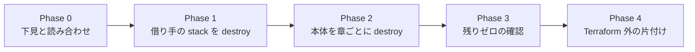

## TL;DR

- 使われなくなった stg 環境（ECS / Aurora / CloudFront / Lambda@Edge / Auth0 / S3 など）を `terraform destroy` で畳みました。**コマンドを打つのは人、Claude はコマンドを出して出力を読む役**、と分けて進めました
- `-refresh=false` の plan では削除対象が **94 件**と出ましたが、出力の途中にリージョン未設定のエラーが埋もれていて、本当は **201 件**でした。`Plan:` の行だけでなく Error の有無も必ず見ます
- 「別管理」と思っていた stack が同じ DNS ゾーンや Auth0 を使っていました。借り手は 4 つではなく 6 つでした
- plan の出力には DB のパスワードが平文で出ます。AI との会話に全文を貼らない運用にしました
- Terraform の外にあるもの（DNS の委任、S3 の削除マーカー、別リポの Spot Fleet）は、destroy では片付きません

## はじめに

<!-- hearing:H2 -->
対象は、もう誰も使っていない stg 環境でした。deploy も apply も止まったままで、state の最終更新は約 1 年前です。それでも毎月の費用（月数百ドル規模の見込み）だけはかかっていました。

もう 1 つの理由は、次に本番と同じ構成の環境を消す予定があることです。その前に stg で手順を固めておきたかったので、本番削除の予行演習のつもりで進めました。

作業は Claude Code と組んで進めました。ハマりどころが多かったので、次に同じことをする人（自分を含む）のために手順を残します。あわせて、AI に実行させずに人が打つ分担が効いたので、そのやり方も書きます。

:::message
会社や環境を特定できる情報は書いていません。リソース名・コマンド出力はすべてダミー（`example-stg-*`）に置き換えています。
:::

## 全体像

### 分担: 打つのは人、読むのは AI

<!-- hearing:H1 -->
最初に決めたのは次の分担です。

| 役 | やること | やらないこと |
|---|---|---|
| 人 | AWS CLI と terraform を打つ。書き込み系は上長に見える形で了解を取ってから打つ | 出力の全文を AI に貼る |
| Claude | 次に打つコマンドを 1 つずつ出す。貼られた結果を期待値と突き合わせる | AWS への書き込み。読み取りコマンドも打たない |

読み取り（`describe` / `list` / `plan`）も人が打ちます。Claude はコマンドを平文で出し、人が打って、結果を貼ります。1 回に 1 コマンドなので遅いですが、「何が消えるか」を人が毎回自分の目で見ることになります。

歯止めとして、Claude Code の設定の `deny` に破壊系のコマンドを入れました。

```json
{
  "permissions": {
    "deny": [
      "Bash(terraform destroy *)",
      "Bash(terraform apply *)",
      "Bash(aws * delete-*)",
      "Bash(aws * terminate-*)",
      "Bash(aws s3 rm *)",
      "Bash(aws s3 rb *)"
    ]
  }
}
```

実際には Bash と PowerShell の両方に入れて 12 行にしました。ただしこれは文字列の一致なので、別の書き方をすればすり抜けます。分担のルールが本体で、deny は保険です。

### 進める順番



順番は **借り手 → 貸し手** です。本体の VPC や DNS ゾーンを使っている別の stack（借り手）を先に消さないと、本体の destroy が依存で止まったり、借り手が壊れたりします。

## Step 0: 下見で「何が消えるか」を全部数える

最初にやるのは、関係しそうな全リポ × 全 workspace で `plan -destroy` を打つことです。plan は書き込まないので、何度打っても痕跡は残りません。

```bash
terraform init
terraform workspace list
terraform workspace select stg
terraform state list | wc -l
terraform plan -destroy -no-color > plan-destroy.txt 2>&1
```

`workspace select` で切り替えたら、終わった後に元へ戻して `terraform workspace show` で確認します。dev の workspace のまま destroy を打つ事故を防ぐため、毎回確かめました。

下見で拾うべきものは次のとおりです。

- 本体の VPC・DNS ゾーン・Auth0 などを参照している別の stack（借り手）
- Terraform の外で作られたもの（手作業の SG、Kubernetes のコントローラが作った DNS レコードなど）
- dev や本番と名前を共有しているもの

<!-- hearing:H3 -->
今回は、このうち「借り手」を見落としていました。計画の段階では借り手を 4 つと数えていましたが、作業を進めるうちに 6 つに増えました。「別管理なので触らない」と書いていた別リポの stg の設定に、消す予定の DNS ゾーンの ID と、同じ Auth0 テナントが書かれていたのです。そのまま本体を消していたら、その stack のログイン設定と DNS も一緒に消えていました。

借り手を探すには、本体が持っているもの（ゾーン ID、VPC ID、Auth0 のドメインなど）の値で、他のリポの設定ファイルと SSM パラメータを検索するのが確実でした。

## Step 1: 権限と認証をそろえる

### 権限は「存在しない名前で消してみる」で確かめる

低い権限のロールで plan を打つと、途中で `AccessDenied` で止まります。今回は Auth0 provider が SSM から認証情報を読む作りだったので、`ssm:GetParameter` が無いと plan すら通りませんでした。

消す権限があるかどうかは、**存在しない名前を指定して delete を打つ**と安全に確かめられます。

```bash
aws ecs delete-cluster --cluster example-stg-does-not-exist
```

権限が無ければ `AccessDenied`、権限があれば「見つからない」系のエラーが返ります。どちらにしても何も消えません。この結果を根拠にして、管理者相当のロールを申請しました。

### terraform は `--profile` を読まない

MFA 付きのプロファイルで作った一時鍵を、terraform に渡すのにも手間取りました。terraform に `--profile` は無いので、窓ごとに環境変数へ書き出します。

```bash
eval "$(aws configure export-credentials --profile example-stg --format env)"
export AWS_DEFAULT_REGION=ap-northeast-1
```

PowerShell なら `--format powershell` の出力を `Invoke-Expression` に渡します。新しい窓を開くたびにやり直しになるうえ、一時鍵は 1 時間で切れます。

## Step 2: plan -destroy は `Plan:` 行と Error 行を両方見る

<!-- hearing:H3 -->
一番ハマったところです。

権限が足りない間の代わりとして、`-refresh=false` を付けて plan を打っていました。結果は次のとおりです（値は置き換えています）。

```text
Plan: 0 to add, 0 to change, 94 to destroy.
```

94 件で計画を立てていましたが、権限をそろえて refresh ありで打ち直すと 201 件でした。

```text
Plan: 0 to add, 0 to change, 201 to destroy.
```

原因は、最初の出力の 2,814 行目に埋もれていたエラーでした。

```text
Error: Invalid AWS Region
```

既定の `provider "aws" {}` にリージョンが書かれておらず、環境変数 `AWS_DEFAULT_REGION` に頼る作りでした。その環境変数を入れる前に打っていたので、既定 provider の配下（VPC・Aurora・ALB・ECS など）107 件がまるごと数え落ちていました。94 件は、別名の provider を使う module・Auth0・別リージョンの分だけだったのです。

出力ファイルには `94 to destroy` の行があり、エラーはそこから離れた行にありました。要約の件数だけ拾って読んだので、足りないことに気づけませんでした。それからは、plan を打ったら必ず次の 3 つを見るようにしました。

```bash
terraform plan -destroy -no-color > plan-destroy.txt 2>&1; echo "exit=$?"
grep -n -E '^Plan:|Error:' plan-destroy.txt
terraform state list | wc -l
```

終了コードが 0 でない、または `Error:` が 1 件でもあれば、その plan の件数は信用しません。state の件数（今回は 253 件。うち data が 51、管理資源が 202）とも突き合わせ、消えないものの説明が付くかを確認します。

### plan の出力にはパスワードが平文で出る

<!-- hearing:H3 -->
plan -destroy の出力には、消える前の値がそのまま出ます。今回は DB の接続文字列（パスワード入り）が 6 行ありました。ECS のタスク定義の環境変数に入っていたものです。

別の stack では、plan の全文を Claude との会話に貼ってしまい、DB のパスワードや OAuth の client secret がチャットに載りました。それ以降は次の運用にしています。

- plan の出力はファイルに書き出し、会話には `Plan:` 行と `Error:` 行だけを貼る
- 証跡には、削除対象の住所（`module.xxx.aws_yyy.zzz`）だけを抜き出したファイルを残す

```bash
grep -E '^  # .* will be destroyed' plan-destroy.txt | sed -E 's/^  # (.*) will be destroyed/\1/' > destroy-addresses.txt
```

- plan の出力・state・ロックファイルは `.git/info/exclude` でコミット対象から外す

## Step 3: destroy の前に「消せない設定」を外す

次の 3 つは、destroy だけでは効きません。先に設定を書き換えて apply しておく必要があります。

| 設定 | そのまま destroy すると |
|---|---|
| Aurora の `deletion_protection = true` | 削除が拒否される |
| S3 の `force_destroy = false` | 中身のあるバケットは削除が拒否される |
| CloudFront の `retain_on_delete = true` | ディストリビューションが無効化されるだけで残る |

手順は、ローカルで書き換えて、その資源だけを `-target` で apply し、コミットせずに戻すやり方にしました。

```bash
# 例: S3 の force_destroy を true にしてから
terraform plan -target=module.example.aws_s3_bucket.logs
terraform apply -target=module.example.aws_s3_bucket.logs
terraform state show module.example.aws_s3_bucket.logs | grep force_destroy
git restore .
```

`-target` 付きの plan では、`0 to add, N to change, 0 to destroy` になっていることを確認してから apply します。ここで destroy や add が混ざっていたら止めます。

## Step 4: 借り手から順に、章に分けて destroy

本体は一度に消さず、資源のまとまりごとに 11 の章に分けました。アラーム → ECS → ログ → Aurora → Redis → ALB → S3 → 画面と DNS → Auth0 → VPC → 残り、の順です。各章は「準備 → 実行 → 確認」の 3 つで閉じています。

時間の決まりも作りました。

- 作業は日中だけにする
- 16:00 を過ぎたら Aurora と VPC の章には入らない（途中で止まると翌日まで中途半端な状態が残るため）
- 中断は章の区切りでだけする

章ごとに分けたおかげで、途中で止まっても「どこまで消えたか」が `state list` の件数ですぐ分かりました。

## Step 5: Terraform の外を片付ける

destroy が終わっても、次のものは残ります。

- **plan を通すために作ったダミーの SSM パラメータ**: コードが「存在しなければ止める」ために必須の SSM を読んでいて、stg にだけ無かったので、上長の了解を取ってダミー値を 1 つ作りました。Terraform の管理外なので destroy では消えません。手作業の一覧に入れておきます
- **親ゾーンの NS レコード**: 親ゾーンが別の DNS サービスにある場合、AWS 側のゾーンだけ消すと、行き先のない NS が残ります。第三者にサブドメインを乗っ取られる原因になるので、親の NS を先に消すか、ゾーンを空にして残します
- **Kubernetes が作った DNS レコード**: ゾーンの 17 レコードのうち 15 件は external-dns が作ったもので、2 件は別の stack のものでした。Terraform では消えません
- **S3 の削除マーカー**: バージョニングが有効なバケットは、期限切れのルールを入れても、削除マーカーが消えて空になるまで時間がかかります。今回は設定から 5 日かかりました

## ハマりどころまとめ

| 症状 | 原因 | 対処 |
|---|---|---|
| plan の件数が 94 → 201 に増えた | 既定 provider のリージョン未設定。エラーが出力の途中に埋もれていた | `Plan:` と `Error:` を両方見る。state の件数と突き合わせる |
| 「別管理」の stack が壊れかけた | 同じ DNS ゾーンと Auth0 を使う借り手を見落とした | 本体のゾーン ID などで他リポの設定と SSM を検索する |
| 会話にパスワードが載った | plan の全文を貼った | 出力はファイルへ。会話には要約行だけ |
| 消した踏み台が約 1 分後に復活した | 別リポの Spot Fleet（台数 1 を維持）が持ち主だった | その stack を destroy。dev と共用の 1 個は `state rm` で外してから |
| dev のスケジュールルールまで消えそうになった | ルール名がコードに固定され、dev と stg で同じ名前を共有していた | stg の state から `state rm` で外して残す |
| destroy 中に止まった | 約 63 万件のバケットを空にするのに約 46 分。destroy が 96 分続き、1 時間の一時鍵が切れた | 大きなバケットは先に空にする。鍵の有効時間と所要時間を見積もる |
| Aurora の apply が版の不一致で失敗した | 自動アップデートで、コードの版と実物の版がずれていた | 上長に確認のうえ、実物の版を `-var` で渡して apply |
| destroy が 45 分でタイムアウトした | Lambda の ENI が `in-use` のまま残った | 翌朝 `available` になってから再実行 |
| Auth0 の connection を消すとユーザーも消える | password connection に属するユーザーは connection と一緒に消える | 消す前にユーザー数と扱いを決める |

## 振り返り: 次にやること

<!-- hearing:H4 -->
大きな事故は起きませんでしたが、失敗と見ているものは 3 つあります。

1 つめは下見の漏れです。Terraform の外の資源や、別リポの stack（踏み台の Spot Fleet など）を最初の下見で拾えませんでした。次は、関係しそうな全リポ × 全 workspace で `state list` と `plan -destroy` を先に打ち、件数に「実測」「未実測」を付けて表にします。

2 つめは、件数を確かめずに使ったことです。94 件という数字を、Error の行を見ないまま計画に使いました。plan の件数は、`Error:` が 0 件で、state の件数と説明が付いて初めて使います。

3 つめは時間の見積もりです。S3 の大量削除や削除マーカーの待ちを甘く見ていました。次は消す日の 5 日以上前に Lifecycle のルールを入れ、一時鍵の有効時間と destroy の所要時間も事前に見積もります。

## まとめ

`terraform destroy` 自体は 1 行ですが、安全に畳めるかどうかは、その前の下見と plan の読み方で決まりました。plan は `Plan:` 行と `Error:` 行を両方見て、state の件数と突き合わせます。

AI と組むなら、打つのは人、読むのは AI と分けるのがおすすめです。遅くはなりますが、消えるものを毎回自分の目で見ることになり、AI の読み違いにも人が気づけます。

## 参考リンク

- [Command: plan | Terraform](https://developer.hashicorp.com/terraform/cli/commands/plan)
- [Command: destroy | Terraform](https://developer.hashicorp.com/terraform/cli/commands/destroy)
- [aws configure export-credentials | AWS CLI Command Reference](https://docs.aws.amazon.com/cli/latest/reference/configure/export-credentials.html)
- [Configure permissions | Claude Code Docs](https://code.claude.com/docs/en/permissions)

<!-- 出典の再検証: bash scripts/verify-sources.sh terraform-destroy-staging-teardown -->
