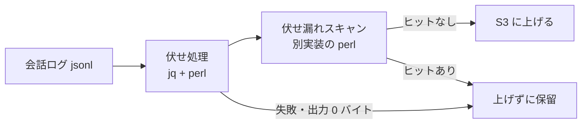
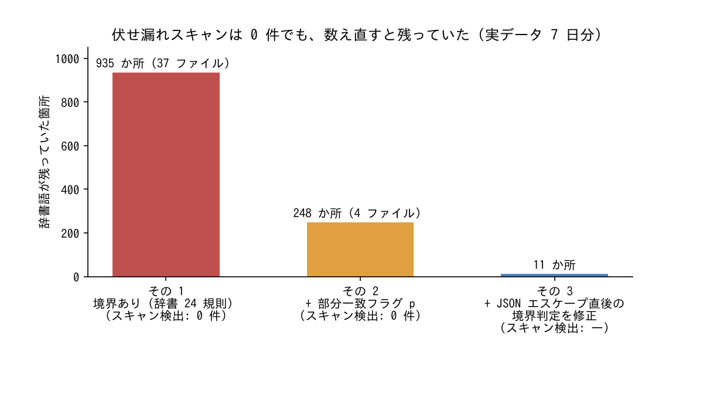

## TL;DR

- Claude Code の会話ログ（jsonl）を S3 に集める前に、**伏せ処理 → 別系統の伏せ漏れスキャン → 通ったものだけ上げるゲート**を shell + jq + perl で作りました
- 最初は会話ログの約 2 割がスキャンで止まりました。正体はほぼ Google Drive の ID や UUID 入りのパスで、本物の秘密は Discord の bot トークン 1 種だけでした
- 社名・人名などの業務辞書を足したあと、**スキャンは 0 件なのに、別の道具で数え直すと辞書語が 935 か所残っていました**。伏せ処理とスキャンが同じ正規表現を使っていて、見落としも共有していたためです
- 架空データのテストは全部 PASS していました。**伏せ処理は最初から実データのコピーで数え直すべきでした**

## はじめに

<!-- hearing:H2 -->
Claude に任せている調査や資料づくりの進め方が、本当に良くなっているのかを毎週測りたい、というのが出発点でした。

週次の計測は手元の PC で会話ログを集計していましたが、1 回に約 27 分かかり、メモリも食います。そこで、PC とクラウドの Claude Code の会話ログを S3 に集め、計測はクラウド側で回すことにしました。

問題は、会話ログに何でも入っていることです。API キーを貼った会話、社名や顧客名が出てくる会話、メールアドレス。これをそのまま S3 に置くわけにはいきません。

この記事は、正規表現で秘密や個人情報を伏せる仕組みを自分で作る人に向けて、作ったものの構成と、誤検知と見落としでハマったところをまとめたものです。

## 全体像

会話ログ 1 ファイルごとに、次の流れを通します。



| 部品 | やること |
|---|---|
| 伏せ処理 | jsonl を 1 行ずつ JSON として読み、文字列の値だけを置き換える。出力の各行が必ず JSON として読める |
| 伏せ漏れスキャン | 伏せた後のファイルを、伏せ処理とは別の正規表現で生の行のまま調べる。ヒットは「行番号と種別」だけ出し、秘密そのものはログに出さない |
| ゲート | 2 つを順に呼び、どちらかが失敗したら出力を残さない。呼び出し側は exit 0 のときだけ上げる |

ゲートの終了コードは次のように分けました。

| exit | 意味 |
|---|---|
| 0 | 上げてよい |
| 2 | 引数の不備 |
| 3 | 伏せ処理が失敗した |
| 4 | 伏せ処理の出力が 0 バイト |
| 5 | 伏せ漏れスキャンがヒットした |

元のファイルは決して上げません。「失敗したら上げない」側に倒すのが基本方針です。

## Step 0: トークン類を伏せる辞書を作る

API キーやトークンは、形の決まった正規表現で伏せます。辞書は 1 行 1 規則の TSV にしました。

```tsv
str github_token - ghp_,gho_,ghu_,ghs_,ghr_ {{L}}gh[pousr]_[A-Za-z0-9]{36,}
str aws_access_key - akia,asia {{L}}(?:AKIA|ASIA)[0-9A-Z]{16}(?![0-9A-Za-z])
str bearer i bearer (?<k>{{L}}Bearer\s+)[A-Za-z0-9._~+/=-]{8,}
key json_key i pass,secret,token,key,credential,authorization ^{{KEY}}$
```

列は「種別・名前・フラグ・ヒント・正規表現」です。工夫したのは次の 3 点です。

- **ヒント列**: jq は正規表現を呼ぶたびにコンパイルし直すので、全部の文字列に全規則を掛けると遅くなります。「この規則に一致する文字列なら必ず含む固定文字列」をヒントに書き、それを含む文字列にだけ正規表現を掛けます
- **語の境界を自前で書く**: jq の `\b` は Unicode 対応で、「接続先https://…」のように日本語と英字が続くと境界になりません。英数字と `_` だけを見る `{{L}}` / `{{R}}` を部品として定義しました
- **名前付きグループで前後を残す**: `(?<k>Bearer\s+)` のように残したい部分を名前付きで書き、値の部分だけ `***` にします

最終的にトークン類の規則は 26 本になりました。

## Step 1: 伏せ漏れスキャンを別実装で書く

伏せ処理の後に、もう一度ファイルを調べます。伏せ処理と同じ仕組みで調べると、同じ所を見落とすからです。スキャンは JSON をデコードせず、生の行を perl で見ます。

見ているのは次の 2 つです。

- **既知の接頭辞**: `ghp_` や `AKIA` など、伏せたはずの形が残っていないか
- **高エントロピーの塊**: 英大文字・小文字・数字を全部含み、文字の散らばりが大きい 32〜256 文字。辞書に無い形の秘密を拾うためのものです

ヒットしたら `leak: line 18 high_entropy` のように行番号と種別だけを出して、ゲートが exit 5 で止めます。

## Step 2: 業務の固有名詞を手元の辞書で伏せる

社名・顧客名・製品名・人名・社内ドメインも伏せたくなりました。ただし、これらの語をリポジトリに書いた時点で漏れてしまいます。そこで、**リポジトリには仕組みだけを置き、語は手元の辞書に置く**形にしました。

```tsv
# ~/.claude/redact-patterns.local/50-business.tsv（例はすべて架空）
domain internal i - example-internal.test
word customer_1 i - Example Corp
word product_1 ip - Widgetron
word person_1 - - 架空太郎
```

- 伏せた箇所は `***` ではなく `<customer_1>` のような規則名に置き換えます。名前は消えても「同じ相手の話が続いている」ことは読み返せるようにするためです
- 規則名には本物の名前を入れません（`acme_corp` のような名前だと、伏せたはずの名前が残ります）。英小文字・数字・`_` 以外は読み込み時にエラーにしています
- メールアドレスと電話番号は、辞書が無くても `<email>` / `<phone>` に置き換えます
- フラグ `p` は部分一致です。`Widgetron_SERVER_HOST` のような環境変数名の中の語も伏せます。一般語の一部に当たって誤爆しやすいので、4 文字以上の製品名などにだけ付けます
- クラウドでは辞書の TSV を base64 にして環境変数で渡します（暗号化ではなく、設定画面で改行や空白が崩れないようにするため）

架空データで動かすと、こうなります。

```bash
TRANSCRIPT_REDACT_LOCAL_DIR=./dict bash scripts/transcript-redact.sh in.jsonl
```

```json
{"type":"user","message":{"content":"<person_1>さん（<customer_1>）から <internal> の件。連絡先は <email> / <phone>"}}
{"type":"assistant","message":{"content":"<product_1>_SERVER_HOST を設定し、curl -H 'Authorization: ***' で叩きます"}}
```

辞書の語は、メール・電話番号と一緒に **1 本の正規表現**にまとめ、perl で 1 回だけコンパイルして jq の出力に 1 回だけ掛けています。最初に語ごとに jq で掛ける形で作ったら、辞書 104 規則で処理時間が +57% になりました。1 本にまとめた後は、架空データ 100 MB・辞書 123 規則で経過時間 +2%（46.9 秒 → 47.8 秒）、CPU 時間 +26% です。

## Step 3: 伏せ方を変えたら、S3 の既存分を上げ直す

日次のアップロードは、元ファイルの sha256 で差分を取っています。伏せ処理を強くしても、元ファイルが同じなら上げ直されません。

そこで S3 のメタデータに伏せ処理の版（整数）を持たせ、版が違う記録は伏せ直して上書きするようにしました。

- 版は環境変数で手で上げます。辞書を 1 語直すたびに全件を上げ直さないためです
- 上げ直しは 1 回 50 件まで。残りは翌日以降に回します

## ハマりどころ

### 会話ログの 2 割がスキャンで止まる

<!-- hearing:H3 -->
最初に困ったのは、スキャンが止めすぎることでした。PC の会話ログ 525 件のうち 103 件、約 2 割が exit 5 で止まって S3 に上がりません。日次の実行はこの 103 件を毎回伏せ直すので、1 回約 50 分かかり、毎回「失敗」で終わっていました。

止まった 102 件（1 件は元ファイルが消えていました）のヒットを種別ごとに数えると、729 行のうち 678 行が高エントロピーでした。中身は次のとおりです。

| 正体 | 行 |
|---|---|
| Google Drive / Sheets / Apps Script の ID | 約 350 |
| UUID を含むセッションのディレクトリ名・パス | 約 100 |
| URL のクエリ値（署名や scope など） | 約 80 |
| URL のパス（共有ページの ID など） | 約 40 |
| 環境変数の代入（`KEY=値`）の値 | 約 40 |
| JSON の id / cursor で終わるキーの値 | 約 20 |
| ファイル名 | 約 15 |
| その他の識別子（1 ファイルずつ） | 約 10 |
| **Discord の bot トークン（本物）** | **4（2 ファイル）** |

接頭辞の検出も、画像の base64 の中に `ASIA` + 大文字 16 字や `AIza…` が偶然並んだものを拾っていました。

本物の秘密は Discord の bot トークン 1 種だけで、そもそも伏せ処理の辞書にこの形がありませんでした。対処は次の 2 つです。

- 伏せ処理とスキャンの両方に Discord のトークンと webhook の形を追加する
- スキャンの高エントロピー判定から、識別子の形（直前が `?` `&` のクエリ値、UUID を含む塊、id / cursor で終わるキーの値など）を外す。接頭辞の検出には語の境界と実在の長さを求める

調整後の再スキャンでは、102 件中 95 件が exit 0 になりました。調整後に日次を 2 回流すと、1 回目は 101 件を上げて 56 分、2 回目は上げる物が無く 2 分 23 秒でした。

:::message
同じ日に、インストーラが辞書ディレクトリを配置しておらず、伏せ処理が exit 3 で失敗してアップロードが全件止まる事故もありました。「失敗したら上げない」設計だったので、漏れはせずに止まっただけで済みました。
:::

### スキャン 0 件なのに、辞書語が 935 か所残っていた

<!-- hearing:H3 -->
一番ハマったのはここです。業務辞書（24 規則。ドメイン 2・org 名 2・ID 2・製品名 6・人名 6・顧客名 6）を入れて、直近 7 日分の会話ログのコピー（57 ファイル、260 MB）で試しました。伏せ漏れスキャンの辞書語のヒットは 0 件です。

念のため Python で辞書の語を部分一致で数え直したところ、**37 ファイル・935 か所**に辞書語が残っていました。



残っていたのは、語の前後に英数字や `_` が続く形でした。`xxx_<語>_api` のような識別子、`<語>_SERVER_...` のような環境変数名、ファイル名の一部などです。`word` 規則は「語の端に英数字が続くときは伏せない」仕様なので、仕様どおり伏せていません。そしてスキャンも辞書語については伏せ処理と**同じ正規表現**を使っていたので、同じ所を見落としていました。

架空データで再現すると、こうなります。

```json
{"t":"xExample Corp_api"}
```

伏せ処理を通しても `Example Corp` が残り、スキャンも exit 0 です。トークン類には別実装のスキャンを用意したのに、辞書語では「同じ正規表現で 1 回で済ませる」ことを優先して、検査の独立性を失っていました。

ここからは、別の道具で数え直しながら 2 回直しました。

| 回 | 直したこと | 残り |
|---|---|---|
| その 1 | （境界あり） | 37 ファイル・935 か所 |
| その 2 | 製品名・org 名に部分一致フラグ `p` を付けた | 4 ファイル・248 か所 |
| その 3 | JSON エスケープ `\uXXXX` の直後を区切りとして扱う | 11 か所 |

その 2 で残った 248 か所のうち 244 か所は人名で、全角括弧の直後に名前が来る形でした。生の JSON では `（` が `（` のようなエスケープになることがあり、その末尾の英数字のせいで「語の前に英数字が続いている」と判定していました。

最後の 11 か所は、名前の直前に英字が付いたサブエージェント名（3 か所）、検証作業で自分が打った確認用の文字列（4 か所）、`r_<ID>.json` の形のファイル名（4 か所）でした。影響が小さいので許容して本番に入れました。

処理時間は、その 1 の時点で辞書なしと比べて +7.3%（453 秒 → 486 秒）でした。目標の +20% 以内です。

### 架空データのテストだけで安心していた

<!-- hearing:H4 -->
失敗だったと思っているのは、架空データのテストで安心していたことです。

業務辞書を入れた時点で、架空データのテストは全部 PASS していました。伏せた行がすべて JSON として読めること、モデル名やパスを誤って伏せないこと、処理時間。どれも問題ありませんでした。

それでも 935 か所の漏れは、実データのコピーを別の道具で数え直して初めて見えました。架空データは自分が想像した形しか含みません。環境変数名やファイル名の中に社名が埋まっている形は、想像できていなかった形です。

次からは、伏せ処理を変えたら最初に**実データのコピー（上げない場所）で、伏せ処理と別の道具で数え直す**ところから始めます。

## まとめ

- 伏せ処理の検査は、伏せ処理と別の実装で書く。同じ正規表現で検査すると、見落としも共有します
- 「スキャン 0 件」は「漏れ 0 件」ではありません。実データのコピーを、別の道具（今回は Python の部分一致）で数え直してから本番に入れます
- 誤検知の多くは識別子でした。止めすぎても日次が毎回失敗して運用が回らなくなるので、止まった物の正体を種別ごとに数えてから、除外を最小限に足します

**伏せ処理は架空データの PASS で終わらせず、実データのコピーを別の物差しで数えるまでが 1 セットでした。**

<!-- 出典の再検証: bash scripts/verify-sources.sh transcript-redact-before-s3 -->
