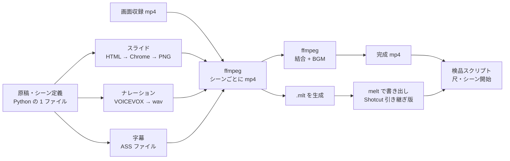

## TL;DR

- 約 230 秒の操作説明動画を、**動画編集ソフトを手で触らずに**作りました。原稿・スライド・収録区間をファイルに書き、Claude Code に「ビルドして」と頼むと mp4 が出てくる形です
- 使ったのは、Claude Code 以外は全部無料のツールです。スライドは HTML を Chrome で PNG にし、ナレーションは **VOICEVOX**、字幕と結合は **ffmpeg**、引き継ぎ用に **Shotcut**（の書き出しエンジン melt）を使いました
- レビューの指摘を受けて、6 日間で 11 版を作りました。1 回の作り直しは 231 秒版で **約 5 分**、350 秒版で約 8 分です
- 仕上がりは目で見る前に「**全体の尺 ±0.5 秒、シーン開始 18 か所 ±0.2 秒**」をスクリプトで検品し、exit 0 なら合格にしました

## はじめに

<!-- hearing:H2 -->
業務で、自社アプリの操作説明動画を作ることになりました。予算はかけられず、外注もしません。

動画編集ソフトで手作業しなかった理由は以下です。

- **修正依頼が多い前提だった**: 説明動画はレビューのたびに「この言い回しを変えて」「この章は外して」と直しが入ります。手作業だと、1 文直すたびにナレーションの録り直し、字幕の打ち直し、後ろのシーンの位置合わせが発生します。原稿を直したら作り直しが終わる状態にしたかったです
- **CapCut だと引き継げなかった**: 自分の環境の CapCut 9.0 では、保存するとプロジェクトファイル（`draft_content.json`）が暗号化されました。外から書き換えたファイルを UI で保存し直すと、二度と読めなくなります
- **編集ソフトしか使わない人に渡したかった**: 自分はコードで作りますが、引き継ぎ先は Shotcut の画面で直せるようにしたかったです。Shotcut のプロジェクト（`.mlt`）は平文の XML なので、コードで生成できて、差分も見られます
- **Claude Code に任せたかった**: 編集ソフトの GUI 操作は AI に任せにくいですが、コードなら Claude Code が版上げを回せます

この記事では、その手順と、作ってみて分かったハマりどころをまとめます。画面は業務のアプリなので載せず、例は架空の家計簿アプリに置き換えています。

## 全体像



動画の本体は ffmpeg で作ります。そのうえで、同じ素材から Shotcut のプロジェクト（`.mlt`）も生成し、Shotcut に同梱の `melt` で書き出しました。引き継ぎ先が Shotcut で開いて直すのはこちらです。

使ったツールとバージョンは以下です。どれも無料で使えます（Claude Code だけは有料のプランで使っています）。

| 役割 | ツール | バージョン |
|---|---|---|
| ナレーション | VOICEVOX エンジン（話者: 四国めたん） | 0.25.2 |
| 字幕の焼き込み・結合・検品 | ffmpeg | 9.0.1 |
| 引き継ぎ用の書き出し | Shotcut（同梱の melt） | 26.6.25（melt 7.40.0） |
| スライドの画像化 | Google Chrome の headless モード | — |
| 全体の制御 | Python | 3.12 |

OS は Windows で、Claude Code から Git Bash と PowerShell を使い分けました。Shotcut のライセンスは GPL v3 です（[COPYING](https://github.com/mltframework/shotcut/blob/master/COPYING)）。

:::message
VOICEVOX の音声は、話者ごとの規約に従います。四国めたんは「**VOICEVOX:四国めたん**」とクレジットを書けば、商用・非商用で使えます（[四国めたんの利用規約](https://zunko.jp/con_ongen_kiyaku.html)）。動画の最後か概要欄に入れておきましょう。
:::

## Step 0: 原稿を 1 ファイルにまとめる

最初に、動画の中身をすべて 1 つの Python ファイルに書きました。シーンごとに「ナレーション原稿」「画面に出すもの」「最低何秒見せるか」を並べるだけです。

```python
# scenes.py（例。実際のアプリは架空の家計簿アプリに置き換えています）
SCENES = [
    scene("SC01", kind="slide", html="slides/title.html",
          narr="家計簿アプリの使い方を、3 分で紹介します。", min_dur=4.0),
    scene("SC02", kind="app", clip="rec/main.mp4",
          lines=[(12.0, 18.5), (18.5, 24.0)],   # 字幕 1 行ごとに使う収録の区間（秒）
          narr="右上の「追加」から、今日の支出を入力します。｜金額を入れて保存すれば完了です。"),
    # ...
]
SKIP_SCENES = []   # 章ごと外したいときはここに ID を足す
```

ここが「正」です。レビューで直しが来たら、このファイルだけを直して作り直します。

Claude Code にはこう頼みました（要旨）。

```text
scenes.py の SC02 のナレーションを「右上の『追加』から支出を入力します。」に変えて、
ナレーションを作り直し、ffmpeg 版と Shotcut 版の両方をビルドして、検品スクリプトを流して。
```

## Step 1: スライドを HTML で書き、PNG にする

タイトルや章の区切りなど、収録画面ではないシーンは HTML で書き、Chrome の headless モードで 1920×1080 の PNG にしました。

```bash
chrome --headless=new --disable-gpu --hide-scrollbars \
  --window-size=1920,1080 --force-device-scale-factor=1 \
  --screenshot=out/SC01.png "file:///.../slides/title.html"
```

右上に置く章のバッジのように背景を透かしたい画像は、`--default-background-color=00000000` を足すと透過 PNG になります。

スライドの見た目を変えたいときは、HTML の文字サイズや配置を直すだけです。「1 章のスライドの文字を大きくして」と頼めば、Claude Code が CSS を直して作り直します。

## Step 2: VOICEVOX でナレーションを作る

VOICEVOX エンジンを起動すると、`http://127.0.0.1:50021` で API が使えます。「読み方を決める（`audio_query`）」と「音声を作る（`synthesis`）」の 2 回呼びます（[VOICEVOX ENGINE の README](https://github.com/VOICEVOX/voicevox_engine)）。

```python
VV, SPEAKER = "http://127.0.0.1:50021", 2   # 2 = 四国めたん（ノーマル）

q = urllib.parse.urlencode({"text": narr, "speaker": SPEAKER})
query = json.load(urlopen(Request(f"{VV}/audio_query?{q}", method="POST")))
query["speedScale"] = 1.05          # 少しだけ速く
query["postPhonemeLength"] = 0.3    # 文末の余韻
query["outputSamplingRate"] = 48000
wav = urlopen(Request(f"{VV}/synthesis?speaker={SPEAKER}",
                      data=json.dumps(query).encode(),
                      headers={"Content-Type": "application/json"},
                      method="POST")).read()
```

できた wav はシーンごとに保存し、次回からは使い回します。原稿を変えたシーンだけ wav を消せば、そのシーンだけ作り直されます。

シーンの長さは「ナレーションの長さ + 1.2 秒」と「最低何秒見せるか」の長いほうにしました。ナレーションが伸びれば、動画も自動で伸びます。

## Step 3: 字幕を作り、ffmpeg でシーンごとに組み立てる

字幕は ASS 形式のファイルを Python で書き出しました。原稿を句読点で 34 文字以内の行に割り、文字数の比でナレーションの時間を配分します。原稿の `｜` は「ここで字幕を改行する」の印で、VOICEVOX に渡す前に取り除きます。

シーンごとの mp4 は、ffmpeg で「画像 or 収録区間 + フェード + 字幕の焼き込み + ナレーション」を 1 回で作ります。

```bash
ffmpeg -y -i clip.mp4 -i SC02.wav -filter_complex \
  "[0:v]ass=SC02.ass,fade=t=in:st=0:d=0.4,fade=t=out:st=13.5:d=0.4[vo]; \
   [1:a]apad=whole_dur=13.9,aresample=48000[ao]" \
  -map "[vo]" -map "[ao]" -t 13.9 -c:v libx264 -crf 20 -pix_fmt yuv420p -r 30 \
  -c:a aac -b:a 192k SC02.mp4
```

収録した画面の区間がナレーションより短いときは最後のフレームで止め（`tpad=stop_mode=clone`）、長いときは最大 1.35 倍まで早回しします。

最後に全シーンを `concat` でつなぎ、BGM を小さめに重ねて完成です。

## Step 4: 同じ中身を Shotcut のプロジェクトにして melt で書き出す

引き継ぎ先が Shotcut で直せるよう、ffmpeg 版と同じ素材から `.mlt` を Python で生成しました。

`.mlt` の書き方は推測で書かず、次の 2 つを手本にしました。

- Shotcut で実際に保存した小さなプロジェクトの `.mlt`
- Shotcut のソースコード（字幕トラックや速度変更の書き方）

トラックは「V1 スライドと収録」「V2 章バッジ」「A1 ナレーション」「A2 BGM」です。書き出しは Shotcut の画面ではなく、同梱の `melt` で行いました。

```bash
melt -quiet project.mlt -consumer avformat:out_shotcut.mp4 \
  f=mp4 vcodec=libx264 preset=veryfast crf=20 pix_fmt=yuv420p \
  acodec=aac ab=192k ar=48000 channels=2 real_time=-1
```

350 秒版の書き出しに 8 分 20 秒かかりました。231 秒版は、ffmpeg 版のビルドから melt の書き出しまで全部で 3 分半〜5 分強です。Claude Code にはバックグラウンドで回してもらい、その間に README を直してもらいました。

:::message
Shotcut で `.mlt` を開いて書き出すときは、書き出し元を「タイムライン」にします。「ソース」にすると、真っ黒・無音の動画になります。
:::

## Step 5: 尺とシーン開始をスクリプトで検品する

見た目のチェックは人がやるとして、その前に「壊れていないか」を機械で確かめました。受け入れ条件は 2 つです。

| 条件 | 測り方 | 許容差 |
|---|---|---|
| 全体の尺 | `ffprobe -show_entries format=duration` | ffmpeg 版の尺 ±0.5 秒 |
| 各シーンの開始位置（18 か所） | `ffmpeg -vf blackdetect` | シーン表の値 ±0.2 秒 |

シーンの開始位置は、**各シーンが 0.4 秒かけて黒にフェードする**ことを使って測りました。黒い区間の真ん中をシーンの境目とみなし、`.mlt` 生成時に出したシーン表（CSV）と比べます。

```powershell
$log = & ffmpeg -hide_banner -i $Mp4 -vf 'blackdetect=d=0:pix_th=0.10:pic_th=0.98' -an -f null - 2>&1 | Out-String
$mids = [regex]::Matches($log, 'black_start:([\d.]+) black_end:([\d.]+)') |
  ForEach-Object { ([double]$_.Groups[1].Value + [double]$_.Groups[2].Value) / 2 }
# シーン表の各行について、いちばん近い黒区間の中央との差が ±0.2 秒以内か
```

最終版の結果は以下でした。

```text
尺: 230.186 秒（基準 230.212 ±0.5）→ PASS
シーン開始: 18/18 PASS
```

24 か所あった v1.4 の検品では、ずれの最大は 0.083 秒（動画の先頭）で、ほかはおおむね 0.03 秒以内でした。条件を満たさなければ exit 1 で止まるので、Claude Code に「検品が通るまで直して」と任せられます。

## 版上げの記録

レビューの指摘を受けて、6 日間で 11 版を作りました（記録に残っている分。下の表は v1.2 以降）。

| 版 | 主な変更 | Shotcut 版の尺 |
|---|---|---|
| v1.2 | Shotcut 版を初めて書き出し | 350.08 秒 |
| v1.3 | 用語の統一（21 か所を一括置換）、BGM を 6 dB 下げる | 350.02 秒 |
| v1.4 | 画面を撮り直した収録 1 本に差し替え | 315.20 秒 |
| v1.5 | ナレーション 1 文を変更 | 315.82 秒 |
| v1.6 | 1 章を外す（24 → 18 シーン） | 231.08 秒 |
| v1.7〜v1.8 | 字幕の位置、スライドの文字サイズ | 231.08 秒 |
| v1.9 | ナレーション 1 文を変更 | 230.19 秒 |

章を外した v1.6 は、350 秒から 231 秒への大きな変更でした。それでも、やったことは除外リストにその章のシーン ID を足して作り直しただけです。後ろのシーンの位置合わせは、検品スクリプトが確かめてくれます。

## Shotcut 版と音量・尺が揃わない

<!-- hearing:H3 -->
一番困ったのは、ffmpeg 版と Shotcut 版が「同じ素材から作ったのに揃わない」ことでした。

- **音量が 3 dB 下がる**: 同じモノラルの wav を melt で書き出すと、ステレオにしたときに -24.7 dB から -27.7 dB に下がりました。モノラルをステレオに広げるときに 3 dB 下げているようです。`.mlt` の出力全体に +3 dB の音量フィルタを足して揃えました
- **最後のフレームで止める機能が無い**: ffmpeg では収録が短いとき最後のフレームで止められますが、Shotcut にはこれに当たる機能がありません。最後のフレームを PNG に書き出し、静止画のクリップとして後ろに置きました
- **尺が少しずれる**: フレーム数の丸めで、Shotcut 版は ffmpeg 版より 0.03 秒ほど短くなりました。許容差を ±0.5 秒にしたのは、このずれを「壊れている」と判定しないためです

ffmpeg 版を「正」にして、Shotcut 版はそれに合わせて検品する、という順番にしてから迷わなくなりました。

## ハマりどころ

### melt で字幕のトラックを足したら画面が真っ黒になった

- **症状**: 字幕を上にずらした透過 PNG を 3 本目の映像トラック（V3）に重ねたら、画面が真っ黒になりました
- **調べ方**: 合成の設定 `a_track` を 0 / 1 / 2 にした `.mlt` を 3 本作り、同じ 1 フレームだけを PNG に書き出して並べました

```bash
melt -quiet test_a1.mlt in=4590 out=4590 \
  -consumer avformat:frame_a1.png f=image2 vcodec=png real_time=-1
```

- **原因と対処**: Shotcut の合成は、どのトラックも V1 のフレームに重ねます。`a_track=2`（すぐ下のトラックに重ねる）ではなく `a_track=1` が正解でした

動画を全部書き出すと 5 分かかりますが、1 フレームなら数秒です。動画のバグは 1 フレームで確かめるのが早いです。

### VOICEVOX が「PC 上」を「ピイシイ ウエ」と読んだ

`audio_query` の結果に入っている `kana` を見ると、読み方を確かめられます。

```text
…この PC 上で…（空白あり） → …ピイシ'イ、ウエデ'…
…この PC上で…（空白なし） → …ピイシイジョオデ'…
```

空白を消して「PC上」と書くだけで「ジョオ」と読みました。辞書登録はしていません。以後、検品の項目に「`kana` が狙いどおりか」を足しました。

### VOICEVOX エンジンが途中で止まっていた

バックグラウンドで起動していたエンジンが、メモリが足りなくなったときに Claude Code によって止められていました。コマンドの失敗ではないので、エラーとしては出てきません。ナレーションを作り直す前に `/version` に問い合わせ、応答が無ければ起動し直す手順にしました。

### Windows で起きたこと

- Git Bash 上の ffmpeg で `drawtext`（画像に文字を描くフィルタ）を使うと、21 回中ほぼ全部が Segmentation fault で落ちました。原因は特定できていません。確認用の画像に時刻を描くのは Python の Pillow に切り替えました
- OpenCV の `cv2.imread` は、日本語を含むパスを渡すと読めずに `None` を返しました。Pillow で開いてから numpy 配列にしました
- 日本語のパスは ffmpeg の字幕フィルタでも扱いにくいので、作業用の出力フォルダは英数字だけの名前にしました
- 検品の PowerShell スクリプトは、Windows PowerShell 5.1 だと ffmpeg の標準エラー出力を例外として扱って落ちます。PowerShell 7（`pwsh`）で動かしました

## 撮り直したほうが早かったこと

レビューで「画面の右下に出ているログの表示は消して」と言われ、最初は動画の上から同じ色の四角で塗りつぶす処理を作りました。結果は「不自然すぎる」で却下でした。アプリの表示設定を変えて撮り直し、塗りつぶしの処理は捨てました。

コードで作っていると何でもコードで直したくなりますが、素材を撮り直すほうが早いこともあります。

## まとめ

<!-- hearing:H4 -->
原稿・スライド・収録区間をファイルにして、ffmpeg でビルドし、尺とシーン開始をスクリプトで検品する形にしたことで、11 版の作り直しを毎回 5〜8 分で回せました。これで完成とは思っておらず、まだ途中です。次の動画も同じ仕組みで作ります。

**編集ソフトを触れなくても、原稿を直して「作り直して」と頼めば動画が直る**、というところまでは無料のツールと Claude Code でできました。

## 参考リンク

- [VOICEVOX ENGINE（GitHub）](https://github.com/VOICEVOX/voicevox_engine)
- [四国めたん 音源利用規約](https://zunko.jp/con_ongen_kiyaku.html)
- [Shotcut](https://shotcut.org/)
- [MLT Framework（melt）](https://www.mltframework.org/)
- [FFmpeg Filters Documentation（blackdetect / ass / tpad）](https://ffmpeg.org/ffmpeg-filters.html)

<!-- 出典の再検証: bash scripts/verify-sources.sh voicevox-melt-video-build -->
